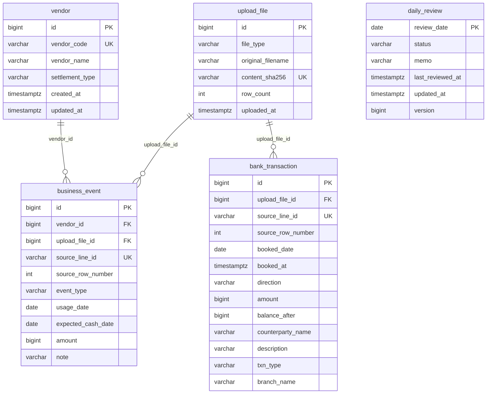

# 입출금 대사 시스템

업무상 입출금 예정 금액과 은행의 실제 거래 내역을 비교하는 Java/Spring Boot 프로젝트입니다.

업무 데이터와 은행 거래 내역을 CSV로 등록하면 날짜별·월별 금액 차이를 조회할 수 있습니다. 차이가 발생한 날짜의 원본 거래를 확인하고, 검토 결과와 메모를 남길 수 있도록 구현했습니다.

## 개발 배경

회계·정산 업무를 하면서 입출금 예정 내역과 통장 거래를 스프레드시트로 비교하는 작업을 경험했습니다. 금액이 다르면 원본 내역을 다시 찾아야 했고, 이미 확인한 날짜도 거래가 추가되면 다시 검토해야 했습니다.

이 과정을 직접 구현해 보고자 프로젝트를 시작했습니다. CSV를 저장하고 합계를 조회하는 기능에서 출발해, 집계에 포함된 원본을 추적하고 검토 상태를 관리하는 기능을 추가했습니다.

현재 대사 기준은 날짜별·월별 합계입니다. 업무 거래와 은행 거래를 한 건씩 연결하는 자동 매칭은 구현하지 않았습니다.

## 사용 흐름

1. 거래처 코드, 이름, 선불·후불 정산 방식을 등록합니다.
2. 업무 CSV와 은행 CSV를 각각 업로드합니다.
3. 일별·월별 화면에서 예정 금액과 실제 금액의 차이를 확인합니다.
4. 날짜 상세 화면에서 집계에 포함된 업무·은행 원본을 조회합니다.
5. 확인한 내용에 따라 검토 상태와 메모를 저장합니다.
6. 검토를 마친 날짜에 거래가 추가되면 재확인 필요 상태로 바뀝니다.

Spring Boot 앱에서 API와 HTML/JavaScript 화면을 함께 제공합니다.

## 주요 기능

| 기능 | 내용 |
| --- | --- |
| 거래처 관리 | 등록, 목록·단건 조회, 이름과 정산 방식 수정 |
| CSV 업로드 | 업무 CSV, 은행 기본 6열 CSV, 우리은행 거래내역 7열 CSV 지원 |
| 중복·입력 검증 | 파일 해시와 거래 ID 중복 확인, 날짜·금액 등 입력값 검증 |
| 일별·월별 대사 | 예정 입금·출금과 실제 입금·출금을 각각 집계하고 차이 조회 |
| 원본 조회 | 날짜별 거래, 업로드 ID, CSV 원본 행 번호 확인 |
| 업로드 이력 | 저장에 성공한 파일 목록과 상세 정보 조회 |
| 검토 관리 | 날짜별 검토 상태·메모 저장, 원본 변경 시 재확인 처리 |

### 집계 기준

입금과 출금은 따로 비교합니다. 입금 차이와 출금 차이가 서로 상쇄되어 보이지 않도록 하기 위해서입니다.

| 구분 | 업무 데이터 | 은행 데이터 |
| --- | --- | --- |
| 입금 비교 | 충전·정산 예정 금액 | 실제 입금액 |
| 출금 비교 | 환불 예정 금액 | 실제 출금액 |

이용 내역인 `USAGE`는 저장하지만 현금 집계와 날짜별 업무 원본 조회에서는 제외합니다.

월 합계가 같더라도 날짜별 차이가 남아 있을 수 있습니다. 월별 조회에서는 차이가 발생한 날짜 수를 `differenceDayCount`로 함께 제공합니다.

### 은행 CSV

기본 6열 양식과 우리은행 거래내역 7열 양식을 지원합니다. 우리은행 양식은 거래 표만 추출한 UTF-8 CSV를 사용하며, 거래일시·거래구분·기재내용·잔액·취급점 정보를 보존합니다.

우리은행 양식의 `source_line_id`는 거래일시·입출금 구분·금액·잔액으로 생성합니다. 은행에서 발급한 고유 거래번호가 아니므로, 이 값이 모두 같은 별도 거래는 구분하지 못할 수 있습니다. 기본 양식과 우리은행 양식 사이의 동일 거래 중복도 현재는 식별하지 않습니다.

## 주요 설계

### 중복 업로드와 부분 저장 방지

같은 파일을 다시 올리는 경우는 파일 내용의 SHA-256 해시로 확인합니다. 거래 중복은 각 거래 테이블의 `source_line_id`로 확인하고, DB에도 UNIQUE 제약조건을 적용했습니다.

업로드 정보와 거래 데이터는 하나의 트랜잭션으로 저장합니다. 중복 거래가 있거나 저장에 실패하면 해당 요청 전체를 롤백해 일부 행만 남지 않도록 했습니다.

원본 파일 자체는 보관하지 않고, 파싱한 거래 데이터와 업로드 정보를 저장합니다.

### CSV 파싱과 DB 저장 분리

Facade에서 파일 읽기와 파싱을 먼저 수행하고, 검증이 끝난 데이터를 저장 트랜잭션으로 전달합니다. 파싱에 실패하면 DB 저장을 시작하지 않습니다.

파일 한도와 오류 수집, 업무·기본 은행 양식의 금액 처리는 공통 코드로 관리합니다. 우리은행 양식은 별도의 금액 해석 규칙을 적용합니다.

### 업무·은행 데이터를 각각 집계

업무 데이터와 은행 데이터를 각각 날짜별로 집계한 뒤, 양쪽에 존재하는 날짜를 모아 금액을 비교합니다. 한쪽에만 내역이 있는 날짜도 조회 결과에 포함합니다.

집계 쿼리는 CTE와 `GROUP BY`를 사용하며, 날짜 목록은 `UNION`으로 구성합니다.

### 원본 변경에 따른 재검토

검토를 마친 날짜에 거래가 추가되면 기존 검토 결과를 다시 확인할 수 있도록 상태를 변경합니다.

| 상황 | 처리 |
| --- | --- |
| 사용자가 검토 결과 저장 | 미검토 또는 검토 완료로 저장 |
| 검토 완료 날짜에 업로드로 원본 추가 | `REVIEWED` → `NEEDS_RECHECK` |
| 재확인 후 사용자가 검토 완료로 저장 | `NEEDS_RECHECK` → `REVIEWED` |

금액 차이가 이전과 같더라도 원본이 바뀌면 재확인 대상으로 처리합니다. `NEEDS_RECHECK`는 업로드 시 시스템이 부여하며, 사용자가 직접 저장하는 상태는 아닙니다.

### 검토 저장 시 동시 수정 확인

업로드와 검토 저장이 동시에 실행되는 상황을 고려해 날짜 단위 잠금을 사용합니다. 검토 저장 시에는 요청의 `version`과 현재 검토 행의 버전을 비교하고, 다르면 HTTP 409를 반환합니다.

이 `version`은 `daily_review` 행의 낙관적 잠금 값입니다. 검토 저장은 상태와 메모를 변경하며, 업무·은행 원본 거래를 수정하지 않습니다.

## 학습용 자료구조 구현

거래 비교에 사용하는 해시 집합의 동작을 이해하기 위해 `learn` 패키지에 별도의 코드를 작성했습니다. 한 CSV 안에서 같은 비교 키를 가진 행을 찾아 확인 대상으로 모으는 기능입니다.

| 클래스 | 역할 |
| --- | --- |
| `TransactionKey` | 거래일시·입출금 구분·거래기관·금액·거래 후 잔액으로 비교 키 구성 |
| `TransactionKeyHashSet` | 배열과 연결 노드로 해시 집합 구현 |
| `TransactionDuplicateChecker` | 반복된 키를 찾고 해당 키의 모든 행을 입력 순서대로 반환 |

`TransactionKey`의 `equals()`와 `hashCode()`는 위 다섯 항목을 사용합니다. 잔액이 없는 경우(`null`)와 잔액이 0인 경우는 구분합니다.

`TransactionKeyHashSet`은 다음과 같이 구현했습니다.

- `Node[]`에 키를 저장하고, 해시 충돌은 연결 노드로 처리합니다.
- `Math.floorMod()`로 버킷 위치를 계산합니다.
- `contains()`는 해당 버킷에서 `equals()`로 키를 비교합니다.
- `add()`는 이미 있는 키면 `false`를 반환하고, 새 키면 저장합니다.
- 기본 용량은 16이며, 적재율 0.75를 기준으로 배열 크기를 두 배로 늘립니다.
- 핵심 저장·조회에는 `HashSet`, `HashMap`, `LinkedList`를 사용하지 않습니다.

`TransactionDuplicateChecker`는 두 번 순회합니다. 첫 번째 순회에서 반복된 키를 찾고, 두 번째 순회에서 그 키에 해당하는 모든 행을 수집합니다. 같은 키가 3번 등장하면 첫 번째 행까지 포함해 3행 모두 확인 대상으로 반환합니다.

이 코드는 학습용이며 실제 업로드 API에는 연결하지 않았습니다. 업로드의 중복 검증은 파일 해시, `source_line_id`, DB 제약조건으로 처리합니다. 학습용 비교 키의 거래기관 항목도 우리은행 취급점으로 자동 대체하지 않습니다.

## 기술 스택

| 구분 | 기술 | 용도 |
| --- | --- | --- |
| 언어 | Java 21 | 백엔드 구현 |
| 프레임워크 | Spring Boot 4.1.1 | API, 입력 검증, 트랜잭션 관리 |
| 데이터 접근 | Spring Data JPA, JdbcTemplate | 데이터 저장·조회, 집계 SQL 실행 |
| 데이터베이스 | PostgreSQL | 업무·은행 거래 및 검토 데이터 저장 |
| 마이그레이션 | Flyway | V1~V7 스키마 변경 관리 |
| CSV 처리 | Apache Commons CSV 1.14.0 | CSV 파싱 |
| 빌드 | Gradle Wrapper 9.7.1 | 빌드, 테스트, 실행 |
| 화면 | HTML, JavaScript | 업로드, 조회, 검토 화면 |

JPA의 `ddl-auto`는 `validate`로 설정하고, 스키마 변경은 Flyway로 관리합니다.

## 데이터 구조

현재 Java 앱은 아래 다섯 테이블을 사용합니다. 업무·은행 거래에는 업로드 ID와 원본 행 번호를 저장해 집계 결과에서 입력 데이터를 찾아갈 수 있도록 했습니다.

`daily_review`는 날짜를 기본 키로 사용하는 독립 테이블이며, 다른 테이블과 외래 키로 연결하지 않습니다.



V7에서 추가한 `booked_at`, `balance_after`, `txn_type`, `branch_name`은 우리은행 거래내역을 저장하기 위한 필드입니다. 기존 6열 양식으로 저장한 거래에서는 이 값이 `NULL`입니다.

## 테스트

통합 테스트는 개발 DB와 분리한 PostgreSQL `reconciliation_test`에서 실행합니다. 학습용 자료구조 테스트는 DB 없이 실행합니다.

기록된 실행 결과는 다음과 같습니다.

| 실행일 | 대상 | 결과 |
| --- | --- | --- |
| 2026-10-02 | 통합 테스트 45개 | 45개 통과 |
| 2026-10-06 | `TransactionKeyHashSetTest` 7개, `TransactionDuplicateCheckerTest` 4개 | 11개 통과 |

통합 테스트에는 기본 은행 양식과 우리은행 양식을 검증하는 `BankUploadIntegrationTest` 9개가 포함되어 있습니다. 두 기록은 별도 실행 결과이며, 학습용 코드를 추가한 뒤 전체 통합 테스트를 다시 실행한 기록은 없습니다.

학습용 테스트 실행 명령은 다음과 같습니다. Windows에서 `backend-java` 디렉터리를 기준으로 실행합니다.

```powershell
.\gradlew.bat test --tests "com.smallbiz.reconciliation.learn.*"
```

Gradle 테스트 보고서: `backend-java/build/reports/tests/test/index.html`

## 실행 및 API

실행 프로젝트는 `backend-java/`입니다. JDK 21과 PostgreSQL을 준비하고, DB 연결 환경 변수를 설정한 뒤 앱을 실행합니다.

환경 변수, 실행 명령, 샘플 CSV와 API 호출 예시는 [Java 앱 실행 안내](backend-java/README.md)를 참고할 수 있습니다. 로컬 화면 확인에 사용한 주소는 `http://localhost:8082/`이며, 포트를 변경한 경우 해당 주소로 접속합니다.

| 기능 | API |
| --- | --- |
| 기동 확인 | `GET /health` |
| 거래처 등록·목록 | `POST /api/v1/vendors`, `GET /api/v1/vendors` |
| 거래처 단건·수정 | `GET /api/v1/vendors/{id}`, `PUT /api/v1/vendors/{id}` |
| 업무 CSV 업로드 | `POST /api/v1/uploads/business` |
| 은행 CSV 업로드 | `POST /api/v1/uploads/bank` |
| 업로드 이력 | `GET /api/v1/uploads`, `GET /api/v1/uploads/{uploadId}` |
| 일별 집계 | `GET /api/v1/reconciliations/daily` |
| 월별 집계 | `GET /api/v1/reconciliations/monthly` |
| 날짜별 업무 원본 | `GET /api/v1/reconciliations/daily/{date}/business` |
| 날짜별 은행 원본 | `GET /api/v1/reconciliations/daily/{date}/bank` |
| 검토 조회·저장 | `GET /api/v1/reconciliations/daily/{date}/review`, `PUT /api/v1/reconciliations/daily/{date}/review` |

CSV 업로드는 multipart 요청의 `file` 필드를 사용합니다. CSV 헤더와 집계·검토 규칙은 [설계 문서](backend-java/docs/design.md)에 정리했습니다.

## 현재 범위와 제한

단일 회사·단일 계좌의 원화 정수 데이터를 다루는 로컬 프로젝트입니다. 가상 거래처와 합성 CSV를 기준으로 개발했습니다.

- 로그인과 사용자 권한 관리는 구현하지 않았습니다.
- 은행 Open API 연동과 거래 단위 자동 매칭은 지원하지 않습니다.
- XLS/XLSX 파일은 직접 업로드할 수 없습니다. 우리은행 자료는 계좌 요약·조회 기간 행을 제외한 거래 표를 CSV로 준비해야 합니다.
- 원본 CSV 재다운로드와 실패한 업로드 이력 조회는 지원하지 않습니다.
- 거래처별 은행 대사 확정, 거래처별 업무 원본 조회 API, 토스 전용 CSV, 반복 행 검토 화면은 구현하지 않았습니다.

## 관련 디렉터리와 문서

| 경로 | 내용 |
| --- | --- |
| [`backend-java/`](backend-java/) | 현재 개발 중인 Spring Boot 앱 |
| [`backend-java/README.md`](backend-java/README.md) | 실행 환경, 샘플 CSV, API 호출 예시 |
| [`backend-java/docs/design.md`](backend-java/docs/design.md) | CSV 형식과 집계·검토 규칙 |
| [`app/`](app/) | 별도로 작성한 FastAPI 전표 실험 코드 |
| [`migrations/`](migrations/) | FastAPI 실험용 DB 스키마 |
| [`docs/legacy-erd.md`](docs/legacy-erd.md) | 초기 전표 중심 설계 |

FastAPI 실험 코드는 루트의 SQLite `accounting.db`를 사용하며, Java 앱과 프로세스·데이터베이스를 공유하지 않습니다. `docs/legacy-erd.md` 역시 현재 Java 스키마와는 별도의 초기 설계 문서입니다.
