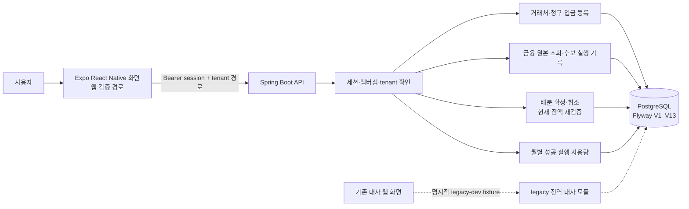

# 아키텍처와 핵심 설계

## 실행 흐름

Expo 앱은 legacy 전역 API를 호출하지 않습니다. 그림의 DB는 같은 PostgreSQL이며 기존/신규 자료는 서로 다른 테이블과 소유권 경계로 분리합니다.

`legacy`는 기존 입출금 예정·은행 거래의 일별 합계 검토를 보존한 별도 경로입니다. 새 receivables 기능은 그 자료를 청구나 입금으로 해석하거나 계정에 자동 귀속시키지 않습니다. FREE/STANDARD와 미인증 호출은 AI 실행 경계에서 거부되고 PRO도 tenant 전용 query 도구를 갖추기 전까지 비활성 상태입니다.

## 선택한 경계와 이유

**서버가 소유권과 잔액 판단을 담당합니다.** 화면은 tenant API에 입력을 보내고 받은 정확한 문자열 금액을 표시합니다. 배분 확정 시 서버는 인증된 계정의 membership을 확인하고 청구·입금 부모를 잠근 후 현재 잔액과 요청 합계를 다시 계산합니다. 화면 사전 검토는 안내 단계이며 잠금 상태를 대신하지 않습니다.

**정수 금액을 끝까지 유지합니다.** V9–V12의 금액은 `BIGINT` 원화 정수입니다. Java 합산은 PostgreSQL `SUM(bigint)`가 반환하는 numeric을 정확히 정수로 변환하고 `BigInteger`로 비교합니다. API 금액은 큰 정수 반올림을 막기 위해 문자열로 전송합니다. JSON/전송 계층에 `BigDecimal`이 나타나더라도 저장 통화/금액 표현이 소수라는 뜻은 아닙니다.

**확정·취소는 감사 가능한 명령입니다.** idempotency command, 요청 hash, 불변 batch/line, confirm/cancel audit가 결과와 같은 트랜잭션에 기록됩니다. 등록 명령의 키 범위도 tenant 및 operation을 포함합니다. 중복 응답은 원래 결과 snapshot을 재생할 수 있으므로 현재 상태 확인은 별도 GET입니다.

**매칭 결과는 시점이 있는 근거입니다.** V11 실행은 선택 범위와 규칙 버전을 기록하고, 한 statement가 읽은 원본/활성 배분 상태를 결과 JSON으로 저장합니다. 다시 실행하면 새 snapshot을 만들며 과거 실행을 갱신하지 않습니다. 후보 0건은 데이터 부재/파일 누락/입금 누락 증거가 아닙니다.

**사용량은 성공 commit에 묶입니다.** V13의 bounded 동기 트랜잭션은 run과 월 usage 행을 잠금 순서대로 다루며 승인 월, event, 완료 수를 함께 커밋합니다. 실패·quota 거부·동일 결과 replay는 성공 횟수를 추가하지 않습니다. 월 경계는 서버 PostgreSQL 시각의 Asia/Seoul 기준입니다. 별도 worker/영구 reservation은 없습니다.

## 구성과 구현 위치

- 인증과 세션: [`account`](../backend-java/src/main/java/com/smallbiz/reconciliation/account), V8 `app_account`, `app_tenant`, `app_membership`, `app_session`
- 등록: [`ReceivablesService`](../backend-java/src/main/java/com/smallbiz/reconciliation/receivables/ReceivablesService.java), V9 counterparty/invoice/payment 및 registration request
- CSV 원본 추적: [`BankImportService`](../backend-java/src/main/java/com/smallbiz/reconciliation/receivables/bankimport/BankImportService.java), V12 import/source row/transaction와 payment 출처 연결
- 후보 snapshot과 사용량: [`MatchingService`](../backend-java/src/main/java/com/smallbiz/reconciliation/receivables/matching/MatchingService.java), [`UsageService`](../backend-java/src/main/java/com/smallbiz/reconciliation/receivables/matching/UsageService.java), V11–V13
- 배분 원장: [`AllocationService`](../backend-java/src/main/java/com/smallbiz/reconciliation/receivables/allocation/AllocationService.java), V10 batch/line/cancellation/audit/command
- 클라이언트: [`mobile`](../mobile), API 호출·초안·재전송 상태는 앱에 두되 최종 배분액/잔액 계산은 서버 응답을 사용

기존 전역 데이터는 V1–V7 스키마에 남고 V8은 identity만 추가합니다. migration 및 정확한 테이블 필드는 [ERD](receivables-erd.md)를 참고하세요.
