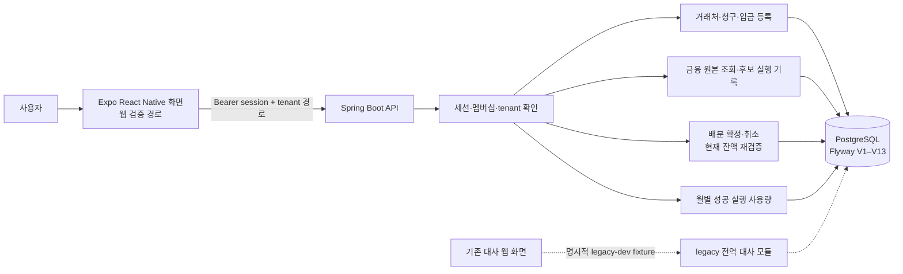
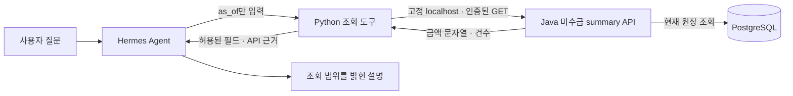

# 아키텍처와 핵심 설계

## 실행 흐름

기존 대사 모듈과 새 미수 관리 모듈은 같은 DB의 서로 다른 테이블을 사용합니다. Expo 앱은 사업체별 미수 관리 API를 호출합니다.

## Java 호출 경계와 트랜잭션

신규 미수금 모듈은 `Controller → Service → JdbcTemplate의 SQL → PostgreSQL` 구조다. 별도 Repository/DAO 또는 JPA 엔티티 계층은 없다. 기존 일별 대사는 `ReconciliationQueryService → ReconciliationAggregationRepository`를 사용하므로 두 구조를 혼동하지 않는다.

대표 확정 흐름은 [`AllocationController.confirm`](../backend-java/src/main/java/com/smallbiz/reconciliation/receivables/allocation/AllocationController.java) → `AllocationService.confirm` → `reserve` → `lockAndValidate` → `audit`다. Controller는 경로·본문을 전달하고 HTTP 오류를 변환한다. Service는 현재 세션·사업체를 다시 확인하고, 키 확보·부모 잠금·합계 검사·배분 및 감사 기록을 한 `TransactionTemplate` 안에서 처리한다.

- 등록: `ReceivablesService.create`/`replayOrCreate`가 원본과 요청 기록을 함께 저장한다.
- 확정·취소: `AllocationService`의 쓰기 템플릿은 `READ_COMMITTED`다. 입금 ID 순서 → 청구 ID 순서로 부모 행을 잠근 뒤 활성 배분 합계를 읽는다. 상세·목록처럼 여러 SQL이 필요한 읽기는 read-only `REPEATABLE_READ`, 개별 잔액·요약은 한 SQL statement를 사용한다.
- 후보·사용량: `MatchingService.create`가 `READ_COMMITTED` 트랜잭션을 연다. `UsageService`의 승인·완료 처리는 `Propagation.MANDATORY`로 이 트랜잭션에 참여한다. 결과와 사용량이 따로 성공하지 않도록 한다.
- CSV: `BankImportService`는 검증 뒤 사업체 행을 잠가 동일 사업체의 import를 직렬 처리하고 원본 근거·입금·명령을 함께 저장한다.

쓰기 중 예외가 발생하면 해당 명령의 전체 트랜잭션을 롤백한다. 저장된 결과 재전송과 현재 상태 조회는 별개다. 상세 API·예외 코드는 각 기능 계약에 남겨 중복 정의하지 않는다.

## 설계 이유와 한계

기존 날짜별 합계가 같아도 청구별 수금이 확인된 것은 아니다. 사용자의 기존 도메인 보존 요구에 따라 새 청구·입금·배분을 별도 모델로 두었고, 후보가 있어도 사용자가 확정해야 잔액이 바뀌도록 했다. 구체적 스키마와 잠금 방식은 에이전트가 구현한 현재 코드에서 확인한 내용이며, 개발자가 직접 선택했다는 뜻은 아니다.

부모 행 잠금은 같은 청구·입금의 동시 확정을 직렬화하는 대신 경쟁 요청의 대기 시간이 생긴다. 단일 동기 후보 실행은 사용량과 결과를 함께 롤백할 수 있지만 처리량에 상한을 둔다. 현재 서비스에는 별도 비동기 worker·메시지 큐가 없고, 대량 처리 성능은 측정하지 않았다. 세부 제약과 인덱스의 목적은 [ERD](receivables-erd.md), 실제 재현 결과는 [배분 검토](receivables-allocation-review.md)와 [사용량 검토](receivables-usage-review.md)에 있다.

## 핵심 설계

**서버가 소유권과 잔액 판단을 담당합니다.** 화면은 tenant API에 입력을 보내고 받은 정확한 문자열 금액을 표시합니다. 배분 확정 시 서버는 인증된 계정의 membership을 확인하고 청구·입금 부모를 잠근 후 현재 잔액과 요청 합계를 다시 계산합니다. 화면 사전 검토는 안내 단계이며 잠금 상태를 대신하지 않습니다.

**정수 금액을 끝까지 유지합니다.** V9–V12의 금액은 `BIGINT` 원화 정수입니다. Java 합산은 PostgreSQL `SUM(bigint)`가 반환하는 numeric을 정확히 정수로 변환하고 `BigInteger`로 비교합니다. API 금액은 큰 정수 반올림을 막기 위해 문자열로 전송합니다.

**확정·취소는 감사 가능한 명령입니다.** idempotency command, 요청 hash, 불변 batch/line, confirm/cancel audit가 결과와 같은 트랜잭션에 기록됩니다. 등록 명령의 키 범위도 tenant 및 operation을 포함합니다. 중복 응답은 원래 결과 snapshot을 재생할 수 있으므로 현재 상태 확인은 별도 GET입니다.

**매칭 결과는 시점이 있는 근거입니다.** V11 실행은 선택 범위와 규칙 버전을 기록하고, 한 statement가 읽은 원본/활성 배분 상태를 결과 JSON으로 저장합니다. 다시 실행하면 새 snapshot을 만들며 과거 실행을 갱신하지 않습니다.

**사용량은 성공 commit에 묶입니다.** V13의 bounded 동기 트랜잭션은 run과 월 usage 행을 잠금 순서대로 다루며 승인 월, event, 완료 수를 함께 커밋합니다. 실패·quota 거부·동일 결과 replay는 성공 횟수를 추가하지 않습니다. 월 경계는 서버 PostgreSQL 시각의 Asia/Seoul 기준입니다.

## 구성과 구현 위치

- 인증과 세션: [`account`](../backend-java/src/main/java/com/smallbiz/reconciliation/account), V8 `app_account`, `app_tenant`, `app_membership`, `app_session`
- 등록: [`ReceivablesService`](../backend-java/src/main/java/com/smallbiz/reconciliation/receivables/ReceivablesService.java), V9 counterparty/invoice/payment 및 registration request
- CSV 원본 추적: [`BankImportService`](../backend-java/src/main/java/com/smallbiz/reconciliation/receivables/bankimport/BankImportService.java), V12 import/source row/transaction와 payment 출처 연결
- 후보 snapshot과 사용량: [`MatchingService`](../backend-java/src/main/java/com/smallbiz/reconciliation/receivables/matching/MatchingService.java), [`UsageService`](../backend-java/src/main/java/com/smallbiz/reconciliation/receivables/matching/UsageService.java), V11–V13
- 배분 원장: [`AllocationService`](../backend-java/src/main/java/com/smallbiz/reconciliation/receivables/allocation/AllocationService.java), V10 batch/line/cancellation/audit/command
- 클라이언트: [`mobile`](../mobile), API 호출·초안·재전송 상태는 앱에 두되 최종 배분액/잔액 계산은 서버 응답을 사용

기존 전역 데이터는 V1–V7 스키마에 남고 V8은 identity만 추가합니다. migration 및 정확한 테이블 필드는 [ERD](receivables-erd.md)를 참고하세요.

## 로컬 Hermes 실습 경로

2026-11-04 사용자 PC의 합성 계정으로 확인한 별도 학습 경로다. 제품 FREE 화면에서 호출하는 AI 기능은 아니다. 도구 소스는 [examples/hermes/chagok-local-api](../examples/hermes/chagok-local-api)에 있다. 모델이 URL·tenant·인증 정보를 입력하지 못하도록 제한하고, 프록시·리다이렉트·자동 재시도를 사용하지 않는다. 원본의 금액을 Python이나 모델이 다시 계산하지 않는다.

`asOf`는 현재 원장의 연체 판정일이며 과거 잔액이나 특정일 거래 필터가 아니다. 결과에는 요약 API 근거가 있고 개별 원본 ID는 없다. 인증·접속 실패와 NO_DATA는 구분한다. 로컬 세션 자체는 쓰기 권한도 있으므로 GET 도구 제한을 서버의 읽기 전용 자격증명으로 설명하지 않는다. 제품 적용은 별도 권한 설계·검증이 필요하다.
