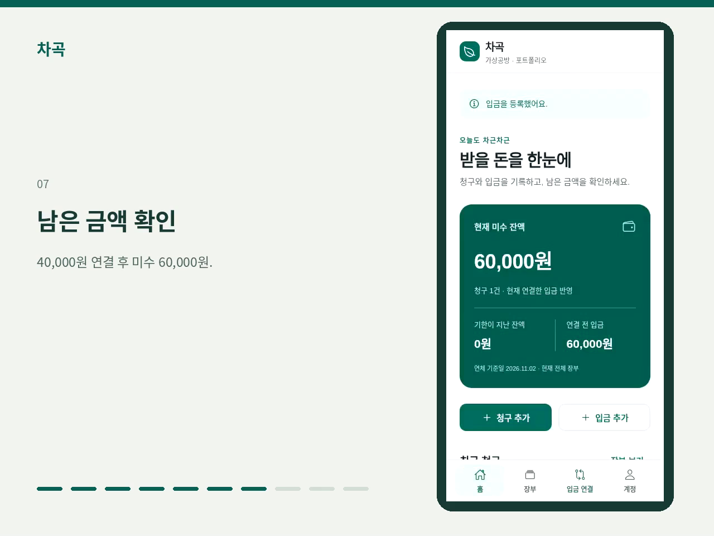

# 차곡 시연 영상

[영상 보기 · 1분 46초](receivables-demo.mp4) · [자막](captions.srt)

[](receivables-demo.mp4)

## 시연 순서

| 시간 | 내용 |
| --- | --- |
| 00:00 | 청구 등록 |
| 00:11 | 청구 상세 |
| 00:20 | 입금 등록 |
| 00:31 | 연결 전 장부 |
| 00:40 | 연결 후보 조회 |
| 00:51 | 40,000원 연결 |
| 01:04 | 미수 60,000원 확인 |
| 01:12 | 나머지 입금 연결 |
| 01:25 | 연결 취소 |
| 01:37 | 미수 60,000원 복구 |

예제 자료를 사용해 브라우저에서 실제 API에 연결한 영상입니다. 계정·거래처와 두 번째 입금은 미리 준비했습니다.

## 다시 녹화하기

로컬 테스트 DB의 API를 8091, Expo를 8081 포트에서 실행합니다. 테스트 DB 연결 정보는 환경 변수로 설정합니다.

```sh
python scripts/record-portfolio-demo.py --output docs/demo
```

필요 도구: Python Playwright, Pillow, Chromium, FFmpeg, Noto Sans CJK.

[미디어 정보·실행 결과](manifest.json)
