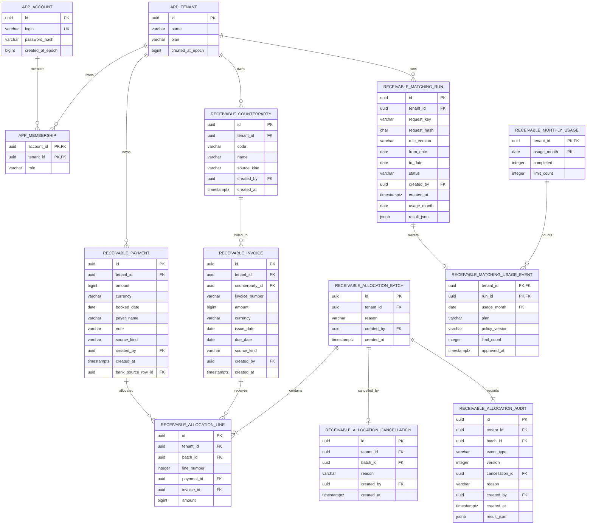

# Receivables 핵심 ERD

아래 그림은 포트폴리오 검토에 필요한 소유권, 핵심 금융 기록, 배분 감사, 후보 실행 및 usage 관계만 표시합니다. 모든 legacy 테이블과 보조 idempotency/import provenance 테이블을 한 그림에 나열하지는 않습니다. 표시한 필드와 관계는 V8–V13 migration을 기준으로 합니다.

## 읽는 법과 정확성

`receivable_invoice.amount`와 `receivable_payment.amount`는 원화 양수 정수 `BIGINT`입니다. 배분 line도 정수입니다. 청구 미수금은 원 청구액에서 취소되지 않은 배분의 합계를 빼고, 입금 미배분액도 같은 방식으로 계산합니다. 초과 입금은 미수금 음수로 상계하지 않고 입금 쪽 미할당 잔액으로 남깁니다. 취소는 원 batch/line을 지우지 않고 취소 사실과 감사 이벤트를 추가합니다.

테이블의 `tenant_id`는 소유 범위이고 여러 자식 테이블은 `(tenant_id, id)` 복합 외래 키로 다른 사업체 자원 참조를 막습니다. 그림은 tenant 간 동일 식별자 참조가 되지 않도록 migration에 실제 설정된 복합 FK의 세부 인덱스/제약을 전부 표시하지 않습니다. 단순 ER 화살표는 전체 권한 프로토콜을 대체하지 않습니다.

V12의 `receivable_bank_import`, `receivable_bank_source_row`, `receivable_bank_transaction`, `receivable_bank_import_request`는 CSV 파일 메타데이터, 행별 6개 원문 셀, 중복/출금 결과, 안정 거래 식별자를 기록합니다. 입금 payment는 bank source row와 연결될 수 있습니다. 사용자 제공 안정 거래 ID와 원본 행 번호는 provenance이지 은행 계좌 인증이나 거래 진위 증명은 아닙니다. 출금은 payment로 변환하지 않습니다.

V9의 `receivable_registration_request`, V10의 `receivable_allocation_command`는 tenant/operation/request key 및 요청 hash와 결과를 연결합니다. 이는 명령 재전송을 안전하게 처리하기 위한 보조 관계라 핵심 도메인 그림에는 생략했습니다. V8–V13의 정확한 스키마는 [`db/migration`](../backend-java/src/main/resources/db/migration)을 확인하세요.
