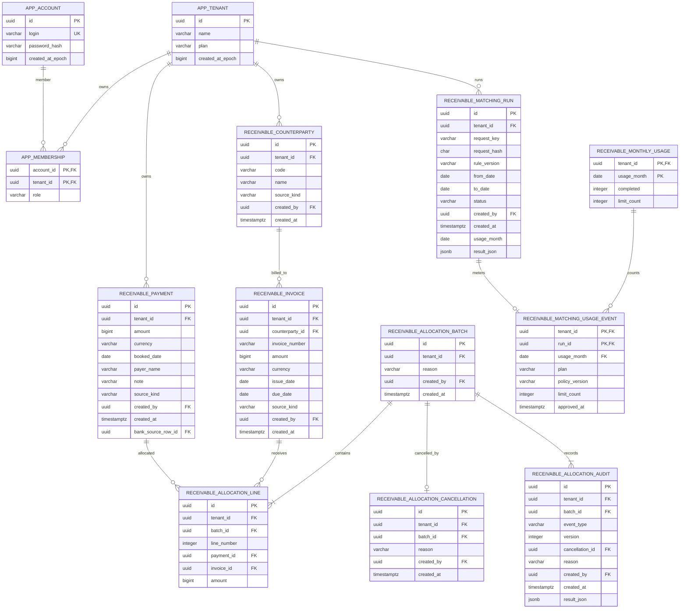

# 미수금 핵심 ERD

청구·입금·배분·취소와 사업체 소유권의 관계입니다.

## 데이터 규칙

- 금액은 원화 정수로 저장합니다. 청구 미수와 입금 잔여는 활성 배분을 기준으로 계산합니다.
- 취소는 원본과 배분 행을 삭제하지 않고 별도 이력으로 기록합니다.
- 사업체 조건과 복합 외래 키로 다른 사업체의 자료 참조를 막습니다.
- CSV 출처와 중복 요청 기록은 보조 테이블에서 관리합니다.

[마이그레이션 원본](../backend-java/src/main/resources/db/migration) · [배분 규칙](RECEIVABLES_ALLOCATION.md) · [CSV 등록](RECEIVABLES_IMPORT.md)

## DB 제약과 조회 경로

`V9`는 사업체별 거래처 코드·청구번호 유일성과 `(tenant_id,id)` 복합 키를 둔다. 청구→거래처 및 `V10` 배분→청구/입금 관계는 복합 FK로 사업체가 다른 자료 연결을 거부한다. 금액은 양수·원금 상한을 CHECK로 제한한다. 여러 배분의 합계가 원금을 넘는지는 CHECK만으로 보장하지 않으며 `AllocationService.lockParents`와 `checkAvailable`이 잠금 후 검사한다.

`V10`은 batch 안의 청구/입금 쌍과 행 번호, batch별 취소 및 이벤트 종류의 유일성을 보장한다. command→audit FK는 `DEFERRABLE INITIALLY DEFERRED`여서 같은 트랜잭션 안의 저장 순서를 허용하되 감사 결과 없는 명령의 커밋을 거부한다. 원본·배분 행은 확정 후 유지하고 cancellation과 audit를 추가한다.

인덱스는 다음 쿼리의 조건·정렬에 대응한다. 실제 실행계획이나 성능 개선 수치를 측정한 결과는 아니다.

- V9 `ix_receivable_*_page`: 사업체별 `created_at DESC,id DESC` 목록. 청구에는 거래처 필터용 `ix_receivable_invoice_counterparty_page`도 있다.
- V10 `ix_allocation_line_payment` / `ix_allocation_line_invoice`: 사업체·입금/청구별 배분 합산. `ix_allocation_batch_page`: 확정 이력 목록.
- V11 `ix_matching_run_page`: 사업체별 실행 이력 목록. V12 `ix_bank_import_page` / `ix_bank_source_transaction`: 업로드 목록과 거래별 출처 조회.
- V13 월 사용량의 `(tenant_id,usage_month)` PK와 run별 event 키: 월 행 잠금 및 실행별 중복 차감 방지.

전체 테이블을 ERD에 반복하지 않았다. 세션·등록 명령·CSV 출처·배분 명령의 정확한 컬럼과 제약은 [V8–V13 마이그레이션](../backend-java/src/main/resources/db/migration)을 따른다. 원본→배분→취소의 트랜잭션 범위와 롤백은 [아키텍처](architecture.md#java-호출-경계와-트랜잭션)에 정리한다.
